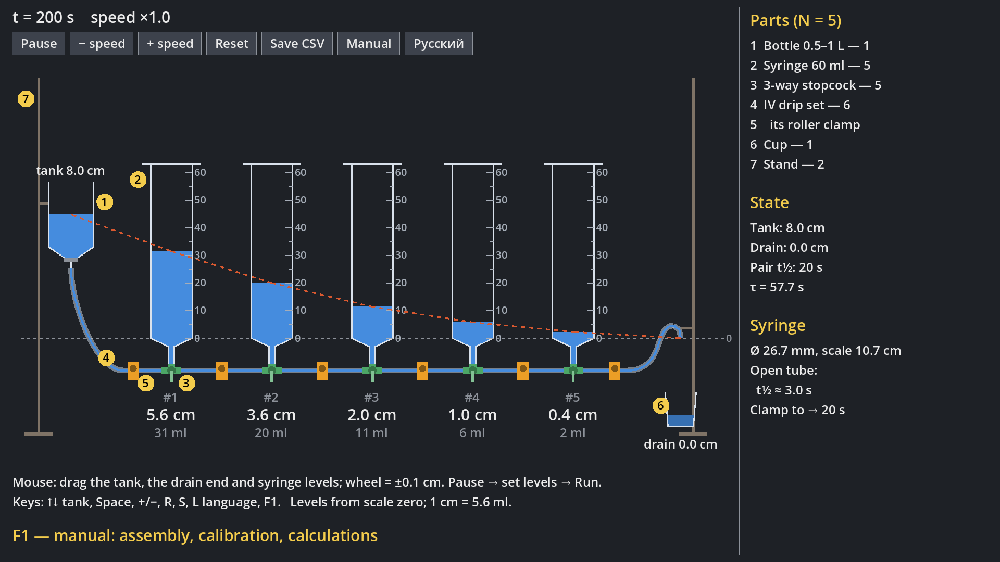
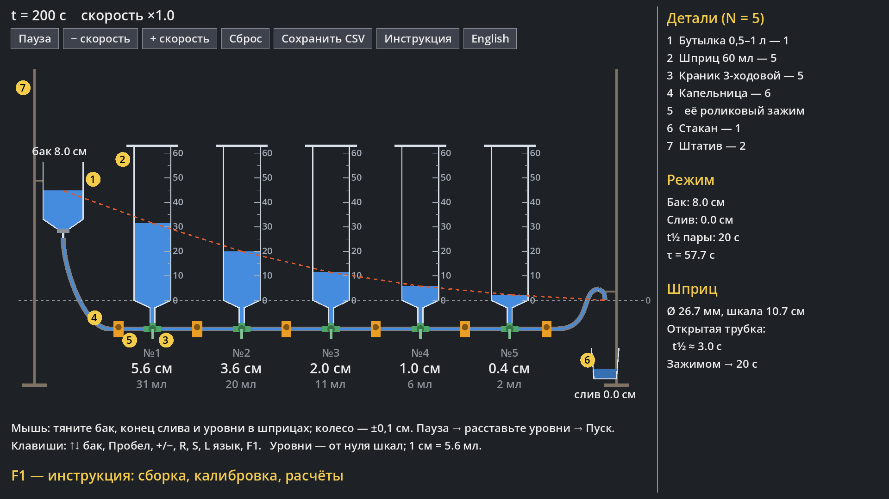

# Lukyanov Hydraulic Integrator

[English](#english) · [Русский](#русский)

## English

A simulation of the one-dimensional **Lukyanov hydraulic integrator** — a 1936 Soviet analog computer
that solved the heat equation with water — and a build scheme for your own rig made from 60 ml
syringes, 3-way stopcocks and IV drip sets. Water level in each syringe plays the role of a layer
temperature; the program is a digital twin you can compare against timelapse footage of the real rig.



**Download (Windows):** the latest build is on the [Releases](https://github.com/avv123avv/lukyanov_integrator/releases/latest)
page — unpack the zip and run `LukyanovIntegrator.exe`. Every merge into `main` publishes a new version automatically.

**Run:** Godot 4.7 → Import → select `project.godot` → F5. The screen is 1920×1080 and scales down
to smaller displays (e.g. Steam Deck). The UI language follows the system on first launch;
switch with the **English / Русский** button or the **L** key.

### Controls

| Keys | Mouse | Action |
|---|---|---|
| ↑ / ↓ | drag the bottle | tank up / down |
| — | drag the drain tube end | drain level |
| — | click / drag inside a syringe | syringe level (initial state) |
| — | wheel over tank, drain, syringe | ±0.1 cm |
| Space | “Pause” button | pause |
| + / − | “± speed” buttons | time speed ×2 / ÷2 |
| R | “Reset” | reset |
| S | “Save CSV” | readings to `user://lukyanov_levels.csv` |
| [ / ] | “± inflow” buttons | inflow into each syringe (heat source, e.g. concrete setting) |
| L | “English / Русский” | interface language |
| F1 | “Manual” | in-game manual (←/→ pages, O opens the PDF) |

### Manual

[`docs/instruction_en.pdf`](docs/instruction_en.pdf) — assembly, calibration, how to run calculations,
a worked example, and a history section with problems from real applications (winter concreting,
permafrost, an ice wall around a mine shaft, steel quenching, heat of setting in mass concrete), each set
up on the rig step by step.

Both PDFs and the F1 pages (`docs/pages/<lang>/`) are generated by:

```
pip install reportlab pypdfium2
python docs/build_instruction.py
```

### Calibration

`pair_half_time_s` in the inspector of the `SyringeRig` node is the time for the level difference
between two neighbouring syringes to halve. `syringe_inner_d_mm` is the inner diameter of your syringes.

The original abstract scheme (no syringes) is the `main.tscn` scene.

## Русский

Симуляция одномерного **гидравлического интегратора Лукьянова** (Godot 4.7) — аналоговой машины 1936 года,
решавшей уравнение теплопроводности с помощью воды, — и схема для сборки своей установки из шприцев 60 мл,
трёхходовых краников и капельниц. Уровень воды в шприце — это температура слоя; программа — цифровой
двойник установки для сравнения с таймлапсом.



**Скачать (Windows):** последняя сборка — на странице [Releases](https://github.com/avv123avv/lukyanov_integrator/releases/latest):
распакуйте zip и запустите `LukyanovIntegrator.exe`. Каждое слияние в `main` автоматически выпускает новую версию.

**Запуск:** Godot → Import → выбрать `project.godot` → F5. Экран 1920×1080 (масштабируется под меньшие).
Язык интерфейса при первом запуске — как в системе; переключение — кнопкой **English / Русский** или клавишей **L**.

### Управление

| Клавиши | Мышь | Действие |
|---|---|---|
| ↑ / ↓ | тянуть бутылку | бак выше / ниже |
| — | тянуть конец сливной трубки | уровень слива |
| — | нажать / тянуть внутри шприца | уровень в шприце (начальное состояние) |
| — | колесо над баком, сливом, шприцем | ±0,1 см |
| Пробел | кнопка «Пауза» | пауза |
| + / − | кнопки «± скорость» | скорость времени ×2 / ÷2 |
| R | «Сброс» | сброс |
| S | «Сохранить CSV» | замеры в `user://lukyanov_levels.csv` |
| [ / ] | кнопки «± приток» | приток в каждый шприц (источник тепла, например твердение бетона) |
| L | «English / Русский» | язык интерфейса |
| F1 | «Инструкция» | инструкция внутри игры (←/→ — страницы, O — открыть PDF) |

### Инструкция

[`docs/instruction_ru.pdf`](docs/instruction_ru.pdf) — сборка, калибровка, как проводить расчёты,
пример, историческая справка с задачами (бетон зимой, вечная мерзлота, ледяная стена шахты, закалка,
тепло твердения массивного бетона).

PDF на обоих языках и страницы для F1 (`docs/pages/<lang>/`) собираются скриптом:

```
pip install reportlab pypdfium2
python docs/build_instruction.py
```

### Калибровка

`pair_half_time_s` в инспекторе узла `SyringeRig` — время, за которое разница уровней в паре
соседних шприцев падает вдвое. `syringe_inner_d_mm` — внутренний диаметр ваших шприцев.

Исходная абстрактная схема (без шприцев) — сцена `main.tscn`.
